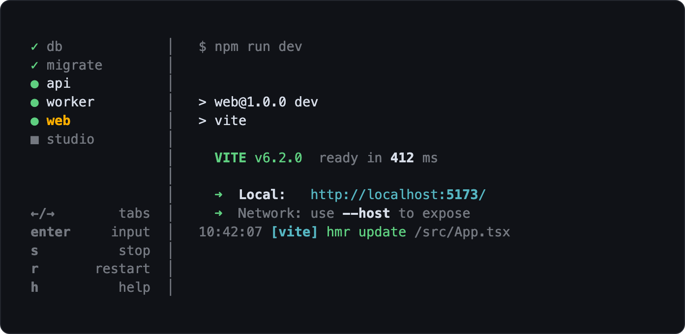

# procup

**processes up** — run your dev processes in one terminal, started in dependency order.



procup waits until a process is actually ready (a migration has finished, a server is listening) before it starts the processes that depend on it. You can type into any process, and stop, start or restart it.

## Install

Requires Node.js 22 or later, on macOS or Linux. Windows is not supported.

|                        | npm                     | pnpm                 | yarn                       |
| ---------------------- | ----------------------- | -------------------- | -------------------------- |
| Run without installing | `npx procup`            | `pnpm dlx procup`    | `yarn dlx procup` (Yarn 4) |
| Add to your project    | `npm install -D procup` | `pnpm add -D procup` | `yarn add -D procup`       |

In a project, add a script to `package.json` and run it with `npm run dev` (or `pnpm dev`, `yarn dev`):

```json
{ "scripts": { "dev": "procup" } }
```

To install it globally instead: `npm install --global procup`.

- pnpm may warn `Ignored build scripts: node-pty`. procup does not need them.
- On Alpine (musl), the prebuilt `node-pty` binary does not load. Install `python3`, `make` and `g++`, then add `--build-from-source` to the `npm install` command.

## Quick start

Create a `.procuprc` file (JSON) where you run procup, usually the project root:

```json
{
  "processes": {
    "db": "docker compose up -d --wait",
    "migrate": { "command": "npm run migrate", "dependsOn": "db" },
    "api": {
      "command": "npm run dev",
      "cwd": "apps/api",
      "dependsOn": "migrate",
      "readyText": "Server listening"
    },
    "web": { "command": "npm run dev", "cwd": "apps/web", "dependsOn": "api" },
    "studio": { "command": "npx prisma studio", "autostart": false }
  }
}
```

Run `npx procup` (or `npm run dev`). `db`, `migrate`, `api` and `web` start one after another, each once the previous one is ready. `studio` starts only when you select it and press `s`.

## How processes start

- procup starts each process automatically: right away if it has no `dependsOn`, otherwise once every process in its `dependsOn` is ready.
- A process is ready when it exits with code 0, or when its `readyText` appears in its output. A server never exits, so give it a `readyText`; otherwise the processes that depend on it never start.
- If a process fails, the processes waiting on it, directly or indirectly, are skipped. Once it is ready again (say you fix it and press `s`), they start, in the same order.
- A process with `"autostart": false` is never started or skipped automatically; you start it with `s`. Processes that depend on it wait until it is ready.
- Dependencies only order automatic starts: `s` starts a process right away, ignoring its `dependsOn`. procup never starts a process a second time on its own, so a process you started or stopped by hand stays that way when its dependencies become ready.
- On quit, a process stops only after every process that depends on it has stopped. Stopping sends `SIGTERM` to the process group, then `SIGKILL` after 5 seconds.

## Configuration

procup reads `.procuprc` from the current directory, or the file given with `--config`. Each key in `processes` is a process name; its value is either a command string or an object:

| Field         | Type                          | Default  | Description                                                                                                        |
| ------------- | ----------------------------- | -------- | ------------------------------------------------------------------------------------------------------------------ |
| `command`     | `string`                      | required | Command to run with `sh -c`.                                                                                       |
| `cwd`         | `string`                      | `.`      | Working directory, relative to where you run procup.                                                               |
| `env`         | `object`                      |          | Environment variables (string values). They override `envFile` and the inherited environment.                      |
| `envFile`     | `string \| string[] \| false` |          | `.env` file(s) to load, relative to `cwd`. Later files win. Read on every start; a missing file fails the process. |
| `dependsOn`   | `string \| string[]`          |          | Processes that must be ready before this one starts.                                                               |
| `readyText`   | `string`                      |          | Text that marks the process as ready when it appears in its output. Plain text, not a regex; colors are ignored.   |
| `showCommand` | `boolean`                     | `true`   | Print `$ <command>` at the top of its output.                                                                      |
| `autostart`   | `boolean`                     | `true`   | `false`: start it by hand with `s`.                                                                                |

`cwd`, `env`, `envFile` and `showCommand` can also be set at the top level, as defaults for every process. A process's own value replaces the default, except `env`, which is merged key by key.

### Variable substitution

Any string value can use variables from the environment procup runs in:

| Syntax             | Result                                                             |
| ------------------ | ------------------------------------------------------------------ |
| `${NAME}`          | Value of `NAME`, or empty.                                         |
| `${NAME:-default}` | Value of `NAME`, or `default` when it is unset or empty.           |
| `${NAME:?message}` | Value of `NAME`, or exit with `message` when it is unset or empty. |

Substitution happens when the config is loaded, so it does not see `env` or `envFile`. To use those in a `command`, write `$NAME` and let the shell expand it.

## Command line

```sh
procup [--config <path>] [--env-file <path>]
```

| Option                  | Description                                                                                                                  |
| ----------------------- | ---------------------------------------------------------------------------------------------------------------------------- |
| `--config <path>`       | Config file to use instead of `./.procuprc`.                                                                                 |
| `-e, --env-file <path>` | Load this file for every process, instead of the configured `envFile`. Relative to each process's `cwd`. `false` loads none. |

Press `Ctrl+C` to quit. `SIGINT` and `SIGTERM` also quit; a second signal exits without waiting for processes to stop. procup exits with code 1 if any process is failed (`✖`) when it quits, and 0 otherwise.

## Keys

| Key           | Action                                                   |
| ------------- | -------------------------------------------------------- |
| `←` `→`       | Previous / next process                                  |
| `1`–`9`       | Go to process 1–9                                        |
| `↑` `↓`       | Scroll one line                                          |
| `PgUp` `PgDn` | Scroll one page                                          |
| `g` `G`       | Scroll to top / bottom                                   |
| `Enter`       | Input mode: keys go to the process until you press `Esc` |
| `s`           | Stop the process, or start it if it is not running       |
| `r`           | Restart the process                                      |
| `h` `?`       | Show / hide help (`Esc` also closes it)                  |
| `Ctrl+C`      | Quit; in help or input mode, leave it instead            |

With the mouse: click a process to select it, scroll the output with the wheel or the scrollbar, and drag over the output to copy it. On Linux, copying needs `wl-copy` (Wayland) or `xclip` (X11).

## Status icons

| Icon       | Status                                                              |
| ---------- | ------------------------------------------------------------------- |
| `○` gray   | pending: waiting for its dependencies                               |
| `⠋` yellow | starting, or waiting for its `readyText`                            |
| `●` green  | running (and ready, if it has a `readyText`)                        |
| `✓` green  | finished: exited with code 0                                        |
| `✖` red    | failed: exited with a non-zero code, was killed, or could not start |
| `⠋` gray   | stopping                                                            |
| `■` gray   | stopped by you, or not started yet (`autostart: false`)             |
| `⊘` gray   | skipped: a dependency failed                                        |

Set `NO_COLOR` to turn off procup's colors.

## Credits

Inspired by [numux](https://github.com/hyldmo/numux) and the `sst dev` terminal.

## License

[MIT](LICENSE)
